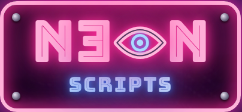
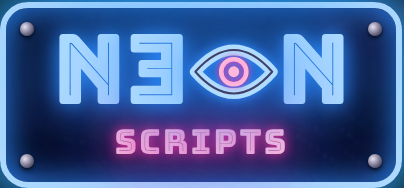
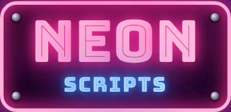
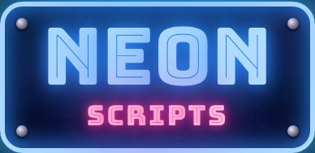

# Versões do logo da Neon Scripts

Histórico da logomarca. A versão em uso fica no topo. Versão antiga não volta para peça nova sem o Brenno pedir.

| Versão | Data | Status |
|---|---|---|
| v3 · Olho | 2026-10-28 | **Em uso** |
| v2 · Placa | 2026-10-25 a 2026-10-27 | Aposentada |
| v1 · neon.scripts | 2026-10-24 | Aposentada |

## v3 · Olho (em uso desde 2026-10-28)

 

- Mesma placa parafusada da v2: NEON em cima, SCRIPTS embaixo em `.355em`, cores opostas que invertem juntas.
- **E ao contrário** (espelhado, `transform: scaleX(-1)`), como no grafite do Brenno.
- **O vira um olho amendoado**: tubo em amêndoa na cor de NEON, íris e pupila na cor de SCRIPTS.
- Movimento: além da falha de letra e da troca rosa/azul, o olho pisca de vez em quando (pálpebra `scaleY(.06)` em ~110ms e volta em 140ms).
- Escolhida entre 4 rodadas de esboço (variação B da rodada 1, com o E ao contrário pedido pelo Brenno). Esboços: https://claude.ai/artifact/GJwraBecMyEeKinzkV2FVw
- Código: `.espelho`, `.o-olho` e `.olho-svg` no `index.html`.

## v2 · Placa (2026-10-25 a 2026-10-27)

 

- Nome mudou para Neon Scripts (com espaço). NEON e SCRIPTS na mesma placa, cores opostas, piscando (PR #2).
- 2026-10-27: placa parafusada, sem cabo (PR #14). SCRIPTS sempre bem menor que NEON (PR #15).

## v1 · neon.scripts (2026-10-24)

- "neon" em Bungee Inline rosa + ".scripts" em Space Mono ciano com cursor de terminal. Ícone de perfil "N_".
- Canvas: https://claude.ai/artifact/LRnrVaDjcLKwApqK48rJz5

## Como criar uma versão nova
1. Esboçar e o Brenno escolher.
2. Trocar no `index.html` (hero e Contato), na imagem `assets/og-neon-scripts.jpg` e nos ícones se mudarem.
3. Salvar prints rosa e azul aqui como `vN-nome-rosa.png` e `vN-nome-azul.png`.
4. Adicionar a versão no topo da tabela e marcar a anterior como aposentada.
5. Atualizar `DESIGN.md` › Letreiro.
